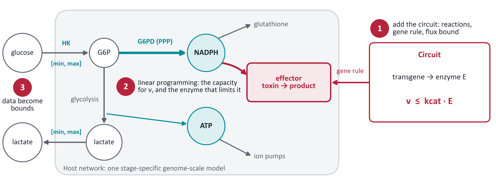
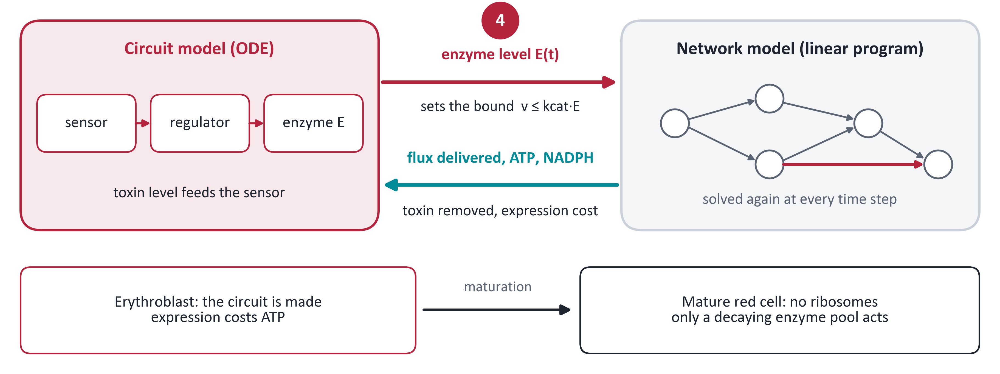
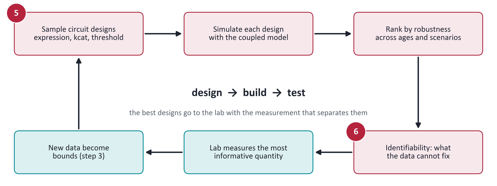

# Coupling a gene circuit model to a metabolic network model

[](https://github.com/raminnashebi/circuit-gem-coupling-demo/actions/workflows/ci.yml)
[](LICENSE)

A small, fully reproducible demonstration of how a model of a synthetic gene circuit can be coupled to a
constraint-based model of cell metabolism, in the setting of an engineered red blood cell.

> **Toy model, synthetic data.** The network, the circuit and every "measurement" are invented or simulated
> by the code. The repository shows how the method works and what kind of answers it gives. No number here is
> a result about real red cells.

## The idea

Treat the circuit and the cell as two models that exchange a few shared variables. The circuit tells the
cell how much enzyme there is, which sets a flux bound (v ≤ kcat · E). The cell tells the circuit how much
flux it can really deliver, given the cofactors (ATP, NADPH) its own maintenance needs.

## The method in six steps






**Level 1, stoichiometric coupling**
1. Add the circuit's effector reaction to the network, tied to a transgene by a gene rule, and bound its flux
   by the enzyme level.
2. Use linear programming to ask whether the effector is feasible, which resource limits it (marginal
   values), and where the safe operating window is.
3. Constrain the network with synthetic exchange rates, tracer fractions and enzyme activities; use flux
   sampling instead of a single objective.

**Level 2, dynamic coupling**

4. Couple an ODE circuit model to the network in time steps: the enzyme level sets the flux bound, the network
   returns the flux the cell can deliver, and the toxin level feeds back to the sensor.
5. Search circuit designs as an ensemble, with a fast lookup of exact linear programming results.
6. Use synthetic time course data to see what is and is not identifiable, and which measurement would
   resolve it.

## What the toy run shows

| | Result |
|---|---|
| Network capacity | The network's capacity is an upper bound on what any circuit design can achieve; for the NADPH effector it falls as G6PD declines with cell age. |
| Safe window | The range of enzyme levels that is both effective and safe narrows with age and closes at about day 58. |
| Coupling in time | The toxin stays under its target until about day 110, but the cell's spare redox capacity falls below its minimum at about day 52. Judged by circuit output alone the design looks successful; only the coupled model shows the host's safety margin is gone. |
| Identifiability | The toxin data fix the product of expression strength and kcat (narrowed by 94%), not each alone (26% and 4%). The enzyme amount at the end of expression separates them. The prediction that matters barely changes across the 76 designs the data allow. |

Read online: the [full report](https://raminnashebi.github.io/circuit-gem-coupling-demo/report.html) and the
[equations, derivations and numerical checks](https://raminnashebi.github.io/circuit-gem-coupling-demo/mathematics.html)
(the same files as [`docs/report.html`](docs/report.html) and [`docs/mathematics.html`](docs/mathematics.html)).

## Quick start

Python 3.11.

```bash
python -m venv .venv
source .venv/bin/activate
pip install -r requirements.txt
make all    # results/results.json, figures, slide figures and both reports (about 20 seconds)
make test   # checks of every headline number
```

## Repository layout

```
circuit-gem-coupling-demo/
├── src/
│   ├── coupling_demo.py    the whole demonstration: network, circuit, data, coupling, designs
│   ├── build_report.py     builds docs/report.html
│   ├── build_math.py       builds docs/mathematics.html
│   ├── slide_figures.py    one-message result figures
│   └── method_figures.py   the three method diagrams
├── results/
│   ├── results.json        every number quoted in the reports
│   ├── figures/            the five report figures
│   ├── slides/             four one-message result figures
│   └── method/             three method diagrams (PNG and SVG)
├── docs/
│   ├── report.html         the method, results, checks and limits
│   └── mathematics.html    the formulation and numerical verification
├── tests/
│   └── test_results.py     internal checks and headline numbers
├── .github/workflows/ci.yml
├── Makefile
├── requirements.txt
├── CITATION.cff
└── LICENSE
```

## Reproducibility

- Every random step uses a fixed seed, so a rerun reproduces `results/results.json` exactly on the same
  platform.
- Package versions are pinned in `requirements.txt`.
- On every push, GitHub Actions installs the pinned environment on a clean machine, reruns the whole pipeline
  and runs the tests against the regenerated results.

## Limits

The network is a teaching toy (no NADH balance, 2,3-BPG, ion and volume dynamics or compartments); the same
model generates and fits the data, so the identifiability results are best cases; a flux balance model gives
no cofactor ratios, which would need a small kinetic core; and the expression stage reuses the mature cell
network. See section 8 of the report.

## Acknowledgement

The code, figures and reports were generated with Claude Opus 5.5 (Anthropic). They are checked by the tests
in `tests/` and by the numerical checks in `docs/mathematics.html`.

## Citation and licence

If you use this work, please cite it as described in [`CITATION.cff`](CITATION.cff). Released under the
[MIT licence](LICENSE).
